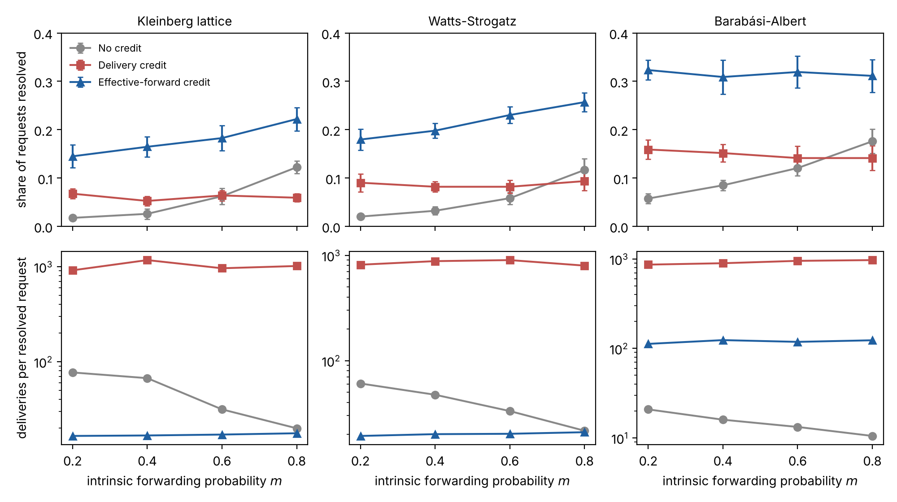

# Cooperation as Routing — simulation and GitHub check

[](https://doi.org/10.5281/zenodo.23753048)

Code for K. Hayashi, *Cooperation as Routing: A Network-Layer Formalization of How Help Propagates Through Social Networks* (manuscript under review).

The simulation is agent-based. It compares three credit rules for intermediaries who forward help requests:

- no credit;
- delivery credit;
- effective-forward credit.

It runs on Kleinberg-lattice, Watts–Strogatz and Barabási–Albert networks with attention fatigue. A calibrated version takes its parameters from @-mention handoffs in GitHub issues (GH Archive, March 2024).

## Requirements

Python ≥ 3.10:

```
pip install -r requirements.txt   # networkx numpy scipy matplotlib (pandas pyarrow for github_handoff/)
```

## Reproduce

| Step | Command | Output | Time (2 cores) |
|---|---|---|---|
| Stylised experiment (Fig. 1) | `python3 routing_sim.py` | `results/sim_results.json` | ~2 min |
| Sensitivity to c and κ (Table 1) | `python3 sens.py` | `results/sensitivity.json` | ~1 min |
| Fit e0 and δ to GitHub response-by-k, then rerun with CIs, sensitivity and scaling | `python3 calibrate.py` | `results/calibrated.json` | ~10 min |
| Sweep base engagement (9 values, 0.25 to 1) with branching ratio | `python3 engagement_sweep.py` | `results/engagement_sweep.json` | ~45 min |
| Figures | `python3 make_fig.py; python3 make_fig_sweep.py; python3 make_fig_branch.py` | figures | seconds |

## Model parameters

`routing_sim.P` holds the defaults. Two engagement parameters were added for calibration; their defaults reproduce the original model.

- `e0`: base probability that a recipient engages (default 1).
- `delta`: dilution when one sender names k recipients at once. Engagement is multiplied by 1 / (1 + (k−1)/δ). The default, `None`, means no dilution.

## GitHub handoffs (`github_handoff/`)

- `run.sh`, `hour.sh`, `extract.py`: download and filter GH Archive hours.
- `load.py`: builds the event table.
- `analyze.py`, `routing_tests.py`: compute the handoff statistics.

`routing_tests.json` holds the aggregate numbers used for calibration:

- hop distribution;
- recipient actions;
- response by number of people named at once;
- sender effective-forward record.

The scripts use only public GH Archive data. Raw events are not redistributed.



License: see LICENSE
